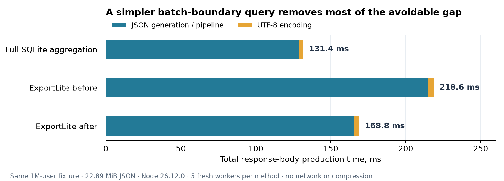

# Batch-boundary profiling and tuning

These historical measurements predate the [UTF-8 byte-path optimization](REMAINING-GAP.md). The preserved source and results remain available.

Measured October 17, 2026. The production change is confined to `src/planner/batches.ts`. The public API, fixed 256-row batches, output loop, cancellation, backpressure, ZIP settings and fallback paths are unchanged.

The original million-user fixture now takes **168.76 ms instead of 218.61 ms** through the public Node writable API: **22.8% less time**. Full SQLite aggregation takes 131.42 ms. The change removes 57.2% of the previous gap, while continuing to deliver batches from one export statement.

## What was expensive

The old recursive query found each batch's bounds by scanning its next 256 keys and calculating `min(key)`, `max(key)` and `count(*)`. It put those bounds in a JSON array and extracted them again for subsequent range comparisons. It then scanned the range's payloads to generate the batch JSON.

Two independent measurements locate the avoidable cost in that SQL:

- The V8 CPU profile attributed 89.6% of sampled wall time to `jsonBatches` and its native iterator descendants before tuning. Native SQLite internals appear as anonymous native frames, so this profile does not identify individual SQLite C functions. Garbage collection accounted for only 25 ms across the roughly 4.67-second profile.
- Changing just the boundary query reduced prepared SQL/driver consumption from **199.74 ms to 151.10 ms** on the million-user fixture. The direct consumer includes minimal batch stitching and UTF-8 byte-length accounting; it excludes the public output writer and response-body buffer allocation.

A separate instrumented public export measured 204.57 ms in native iterator advancement, 3.64 ms in UTF-8 allocation, and 18.36 ms elsewhere before tuning. After tuning these were 152.97, 3.32 and 14.58 ms. Timing every iterator call adds overhead; these diagnostic runs are excluded from the normal benchmark totals.

The initial rotated SQL-only screening also tried JSONB for the old bounds. That took 203.06 ms versus 201.72 ms for the original query, with no useful improvement. The replacement boundary algorithm took 149.97 ms; full aggregation took 128.73 ms. This screening used five warm runs in one process and is supporting evidence, separate from the fresh-process comparison below.

## The small change

Each recursive step now finds the first existing key and the 256th existing key directly, retaining them as two SQLite integers. The latter uses `LIMIT 1 OFFSET 255` after seeking beyond the preceding batch's last key. The offset is always 255, including near the end of a million-row export; it is not growing-offset pagination.

A present 256th key means the batch has exactly 256 rows. If it is absent, only the final short range needs `count(*)`. No key arithmetic or JS conversion of rowids is used. A missing upper boundary is bounded by SQLite's exact maximum signed 64-bit integer. Sparse IDs, negative IDs and both 64-bit extrema retain their original ordering and values.

This removes full-batch boundary aggregate updates and JSON packing/extraction of bounds. It still visits boundary keys and payloads; it does not turn the export into a single table pass. The recursive query remains one prepared export statement with `UNION ALL`, an indexed range scan and a small recursive frontier. EXPLAIN and regression tests find no temporary sort or whole-input materialization. Metadata queries are unchanged.

## Complete public exports

Times are milliseconds. Each cell is the median of five fresh workers, each reporting the median of three timed responses after verification and warmup. The paired generation/encoding values come from the worker at the median total. Generation includes ordinary public API planning and completion of its output pipeline. No network, HTTP framing, compression or disk writes are included in this table.

| Fixture | Implementation | Generation / pipeline | UTF-8 encoding | Total | Process-total range |
|---|---|---:|---:|---:|---:|
| Original: 1M users, 22.89 MiB | Full SQLite | 128.94 | 2.49 | 131.42 | 131.15–131.80 |
| | ExportLite before | 215.13 | 3.47 | 218.61 | 216.19–226.03 |
| | ExportLite after | 165.31 | 3.45 | 168.76 | 167.76–169.00 |
| Varied small: 1M rows, 79.51 MiB | Full SQLite | 418.80 | 17.40 | 436.20 | 433.31–440.82 |
| | ExportLite before | 504.58 | 13.06 | 517.64 | 517.20–523.21 |
| | ExportLite after | 456.35 | 13.14 | 469.48 | 466.51–472.25 |
| Varied large: 100K rows, 96.25 MiB | Full SQLite | 265.80 | 48.31 | 314.11 | 309.45–367.39 |
| | ExportLite before | 279.05 | 65.64 | 344.69 | 342.24–347.83 |
| | ExportLite after | 272.69 | 67.17 | 339.86 | 336.51–341.98 |

Total time falls 22.8%, 9.3% and 1.4% respectively. Saving approximately 50 ms for either million-row fixture but approximately 5 ms for the 100K-row fixture supports the diagnosis of overhead per boundary key. Large payload processing leaves less relative benefit from this change. Full aggregation still wins these median comparisons; the fix preserves the streaming tradeoff.

The default Web stream and actual streaming ZIP paths show the same practical limits:

| Fixture and public output | Before | After | Time reduction |
|---|---:|---:|---:|
| Original, Web stream | 219.81 | 171.00 | 22.2% |
| Varied small, Web stream | 522.12 | 472.08 | 9.6% |
| Varied large, Web stream | 344.95 | 339.23 | 1.7% |
| Varied small, ZIP Web stream | 601.04 | 567.40 | 5.6% |
| Varied large, ZIP Web stream | 730.65 | 729.99 | 0.1% |

ZIP uses the existing level 1 and 256 KiB zlib buffer. ZIP timings use three fresh workers per implementation rather than five. The large-record ZIP difference is within observed process variation; there is no meaningful gain or regression there. Before/after archives have identical encoded bytes and SHA-256 digests. Both optimized archives were independently decoded, checked against the full JSON digest and verified with CRC-32 outside timing.

## Memory and reliability

Median whole-process peak RSS, MiB, for the Node writable comparison:

| Fixture | Before | After | Full SQLite |
|---|---:|---:|---:|
| Original users | 94.8 | 94.7 | 244.9 |
| Varied small | 97.4 | 97.1 | 720.9 |
| Varied large | 262.8 | 261.3 | 853.7 |

These are process high-water marks across imports, verification, warmups and repeated exports. They are not isolated request allocations or hard memory bounds. Natural GC and the response schedule affect the values. Reference JSON is generated in a separate preparation process, so a streaming worker never constructs a complete response merely to verify itself. Different worker setup and response schedules mean these RSS values should not be directly compared with older benchmark reports.

The implementation still holds a fixed number of rows rather than a fixed number of bytes. Large records and downstream buffers can consume substantial memory. Synchronous SQLite work remains interruptible only between operations.

Validation passed:

- **171 tests in five files**, including ESM/CommonJS consumers, Web streams, writable ownership, output errors, partial-file cleanup, cancellation, backpressure, ZIP finalization and concurrent WAL snapshot consistency. Unit tests used Node 24.19.0; profiling and benchmark workers used Node 26.12.0.
- New tests place sparse keys beyond JS's safe integer range and exact 64-bit extrema at full and partial batch ends, exercise both JSON formats, and check columns shadowing the boundary names and two rowid aliases.
- Every benchmark worker verified its response digest and byte count. ZIP bytes agree between implementations; independent archive validation additionally checks decoded SHA-256 and CRC-32.
- 21 limited-root/nested benchmark-adapter cases match the original full aggregation. This is compatibility validation of benchmark tooling, not new relationship support in the public API.
- Type checking, formatting/lint checks and the ESM/CommonJS build pass. Saved baseline hashes and benchmark source fingerprints were verified. The output writer, export loop and public declaration files are byte-identical to the baseline.

No batch-size option, adaptive estimator, new dependency, custom SQLite function or second export query was added.

## Environment, artifacts and reproduction

Same M1 Pro machine, 32 GiB RAM; Node **26.12.0**, V8 **14.6.202.34-node.39**, better-sqlite3 **13.0.3**, SQLite **3.53.4**. Current better-sqlite3 and zip-stream releases were checked before this work; the pinned versions remain 13.0.3 and 7.0.5. No dependency upgrade is part of the change.

The original fixture is the byte-identical copy from the matched API comparison: SHA-256 `2932e4b4087e24ba2d4d6ba12d8ce0aff08f50b4640f0a240683d82d92c9e364`. Its full flat JSON digest is `212a712f71576ae2ac615aeee1847149baa0596c3b592428b649ecff6ffae056`. Varied fixtures use the existing deterministic generator with seed 20261017, note width settings 32/1024 and the row counts above. Fixture metadata records their distributions and hashes.

The experiment ran **117 sequential fresh workers and 351 timed responses**, with rotating implementation order. Verification and one additional warm response precede the three measured responses in every worker. CPU profiles, instrumented runs, fixture creation and independent validation run separately. There is no explicit GC or raised heap limit. SQLite cache reads are warm; this is not a cold-storage or end-to-end HTTP benchmark.

- [Summary JSON](results/batch-profile/summary.json), [CSV](results/batch-profile/summary.csv), [configuration and source hashes](results/batch-profile/configuration.json), [fixture metadata](results/batch-profile/fixtures.json), and [validation](results/batch-profile/validation.json).
- Individual worker observations live under `results/batch-profile/raw/`; `all.json` combines them. Profiles are `before.cpuprofile` and `after.cpuprofile` with a [CPU summary](results/batch-profile/cpu-summary.json). Screening includes query plans and SQLite VM bytecode in `screening.json`.
- The exact original implementation, private benchmark bundle and their manifest are preserved in `baselines/pre-batch-tuning/`. The [previous matched API report](MATCHED-API.md) retains its original measurements.

From the package directory, build using the normal Node 24 development runtime, then build the private benchmark entry with `node benchmarks/matched-api/build.mjs`. The matched benchmark dependency directory must contain the Node 26 build of better-sqlite3 and its pinned Drizzle reference dependency. Keep the original fixture copy at the path recorded in `fixtures.json`; the unchanged generator in `matched-api/reference/setup.mjs` can recreate the same logical data if that original file is unavailable.

Run `node benchmarks/batch-profile/prepare.mjs` under the development runtime to create the varied fixtures and independent JSON reference digests. Then run `BENCH_NODE=/path/to/node26 node benchmarks/batch-profile/run.mjs`; the runner launches every measured worker with that exact Node executable. `worker.mjs` asserts Node 26.12.0 and supports `--profile=path.cpuprofile` and `--instrument=1` for separate diagnostic runs. Use the Node 26 executable for `validate.mjs`, then run `summarize.mjs` after the before/after CPU profiles are present. `plot.py` produces the optional static figure.
